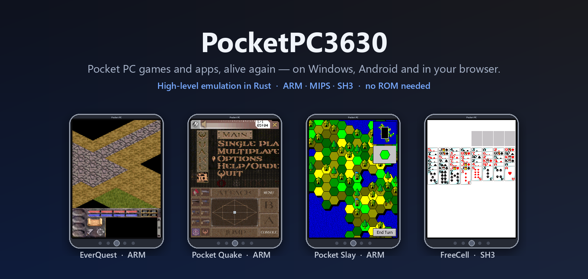
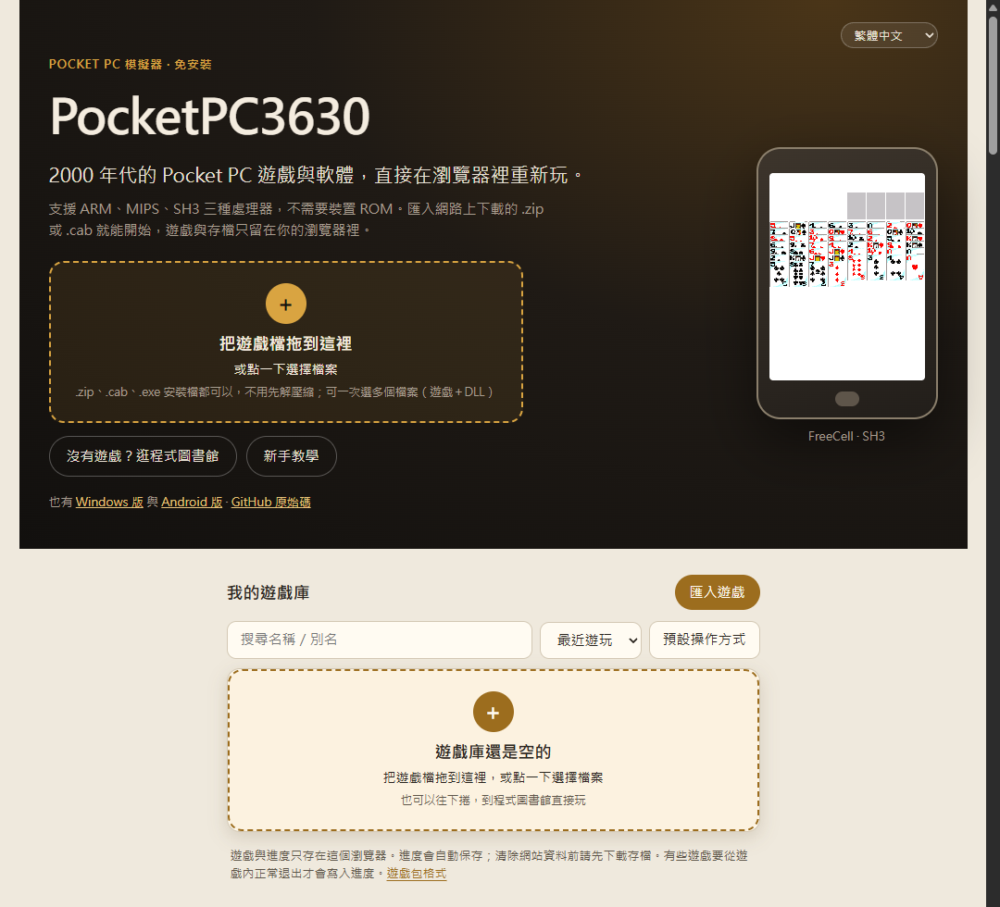
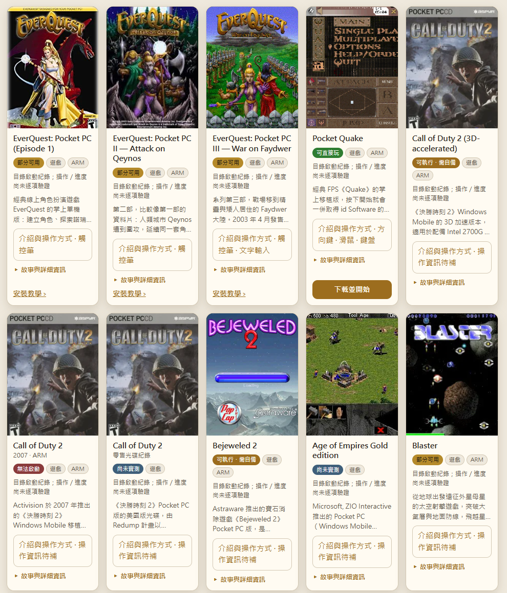
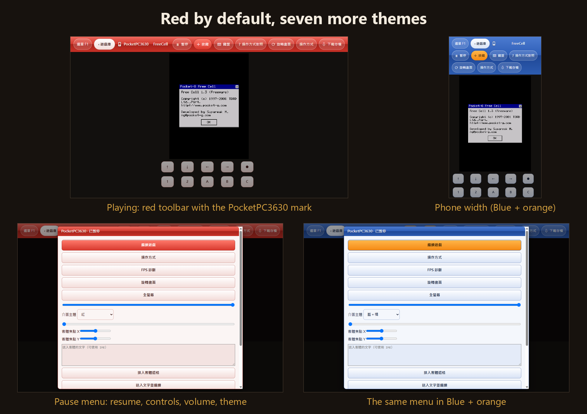
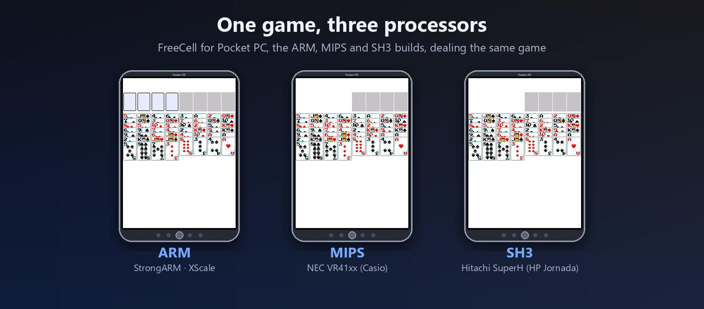
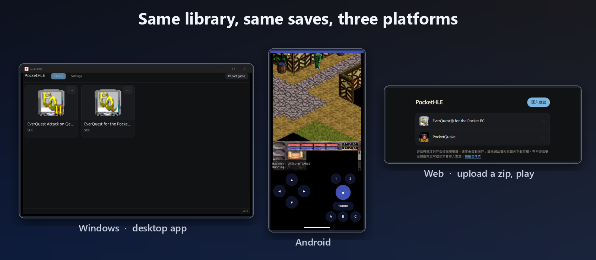
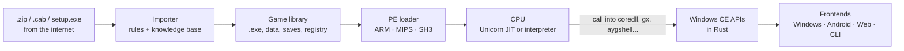

<!--
Copyright (C) 2026 PocketHLE Emulator Project
SPDX-License-Identifier: Apache-2.0 OR MIT
-->

<p align="center">
  
</p>

<h1 align="center">PocketPC3630</h1>

<p align="center">
  <b>Play the Pocket PC library again.</b><br/>
  A high-level emulator that runs Windows CE / Pocket PC games and apps on <b>Windows</b>, <b>Android</b> and <b>in the browser</b>,<br/>
  for all three Pocket PC processors: <b>ARM</b>, <b>MIPS</b> and <b>SH3</b>. No device ROM needed.
</p>

<p align="center">
  <a href="https://szupotseng.github.io/PocketPC3630/"></a>
  <a href="docs/COMPATIBILITY.md"></a>
</p>

<p align="center">
  
  
  
  
</p>

<p align="center">
  <a href="#-play-now">Play</a> ·
  <a href="#-what-it-can-do">Features</a> ·
  <a href="#-compatibility">Compatibility</a> ·
  <a href="#-how-it-works">How it works</a> ·
  <a href="#-build-from-source">Build</a> ·
  <a href="README.zh-TW.md">繁體中文</a>
</p>

---

> ### 👉 Try it now: **[szupotseng.github.io/PocketPC3630](https://szupotseng.github.io/PocketPC3630/)**
> Nothing to install. Pick one of **75 free Pocket PC games and apps** (FreeCell, Pocket Quake, Pocket Slay, mahjong, Tetris, chess...) and press *Download and play*: it is fetched from the Internet Archive, imported and started in one click. A step-by-step guide on the page covers controls, saves, phones and the MFC library.

<p align="center"><a href="https://szupotseng.github.io/PocketPC3630/"></a></p>

The **software library** lists 1,202 Pocket PC programs with box covers, screenshots or program icons.
Every card tells the program's story: what it was, what using it felt like, and how it runs in PocketPC3630 today
(in Traditional Chinese, Simplified Chinese and English; the last part always comes from our own test results).

<p align="center"><a href="https://szupotseng.github.io/PocketPC3630/#library"></a></p>

PocketPC3630 is named after the **Compaq iPAQ H3630**, the StrongARM pocket computer that made Pocket PC famous.
It is a fork of [PocketHLE](https://github.com/j92580498-max/PocketHLE) that grew the original Pocket PC 2002/2003 ARM emulator into a home for the whole Pocket PC era:
the MIPS Casio Cassiopeias and the SH3 HP Jornadas of 2000, a browser version you can open from a link, saves that move between your PC, phone and browser,
and an importer that copes with whatever you actually download from the internet.

Instead of emulating a whole device, it loads the original `.exe`, runs its machine code, and answers the Windows CE calls the program makes
(window messages, GDI drawing, files, the registry, sound, timers) with clean-room implementations written in Rust.
That is why it needs no Microsoft ROM and starts in a second.

## ▶ Play now

| | How | |
|---|---|---|
| 🌐 **Browser** | Open **[szupotseng.github.io/PocketPC3630](https://szupotseng.github.io/PocketPC3630/)**, choose *Import game*, pick a `.zip` or `.cab`. | Nothing to install. Browse the **software library** of 1,202 Pocket PC programs (74 play with one click), in 11 languages, with box covers, screenshots or program icons, a story for every program, filters and sorting. Your games and saves stay in your browser. |
| 🪟 **Windows** | **[Download the zip](https://github.com/SzupoTseng/PocketPC3630/releases/latest/download/PocketPC3630-windows-x64.zip)**, unzip, run `PocketPC3630.exe`, then *Import game*. | Desktop library with icons, saves, keyboard, mouse and Xbox controllers; themes. |
| 🤖 **Android** | **[Download the APK](https://github.com/SzupoTseng/PocketPC3630/releases/latest/download/PocketPC3630-android.apk)** and install it. | Touch controls with a D-pad, action buttons and Turbo; game controllers; themes. |
| ⌨️ **Command line** | `pockethle play MyGame.zip` | For testing, tracing and screenshots. |

PocketPC3630 ships **no games and no Microsoft files**. Bring your own legally obtained packages.

## ✨ What it can do

### A player made for Pocket PC games
<p align="center"></p>

- **Looks like its era.** The glossy Windows Mobile 5/6 look, red by default, with seven more themes
  (*2003 classic* uses the flat blue of a real Pocket PC 2003 screen). The same palette on the web, Windows and Android;
  the theme dresses the player only, the library keeps its own look.
- **A real pause.** The in-game menu (F1, the Menu button or a gamepad's left stick) stops the game's clock, timers and sound together,
  so nothing jumps when you resume. A hidden browser tab pauses by itself.
- **Controls per program.** Eight schemes (stylus first, D-pad and action, full Pocket PC keys, text and reading, mouse and keyboard,
  custom, Windows CE device buttons, the Pocket PC 2003 button panel), each with its own key layout, size, opacity and zoom,
  inherited from your defaults unless you change them for one program.
- **Gamepads and text.** Xbox controllers on Windows, the Gamepad API in the browser, game controllers on Android;
  type names and text with your own keyboard or IME, sent to the game as real characters.
- **Your progress is safe.** Importing a newer copy of a game keeps its saves, registry and settings; backups are ordinary `.zip` files.

<p align="center"></p>

### Three processors, one emulator
Pocket PCs shipped with three different CPUs, and most early software came as three separate builds.
PocketPC3630 runs all of them:

| Processor | Devices | Status |
|---|---|---|
| **ARM** (StrongARM, XScale, PXA, OMAP, S3C) | Compaq iPAQ, HP iPAQ, Dell Axim, HP Jornada 56x | Runs: Unicorn JIT on Windows, a portable interpreter on Android and in the browser |
| **MIPS** (NEC VR41xx) | Casio Cassiopeia E-115/E-125, EM500 | Runs: new interpreter with delay slots, likely branches and unaligned loads |
| **SH3** (Hitachi SuperH) | HP Jornada 54x | Runs: new interpreter, plus SH-specific runtime helpers |

Both new interpreters are checked instruction by instruction against reference CPUs:
**300 random MIPS programs** against Unicorn and **300 random SH programs** against QEMU, plus hand-written tests.
Along the way the SH tests found four bugs in QEMU 8.2's SH-4 emulation (ADDV/SUBV overflow, DIV1 with a zero divisor or `n == m`, and the T bit after ROTL/ROTR),
so those instructions are checked against the hardware manual instead.

### Same library, same saves, everywhere
<p align="center"></p>

- One save format for every platform: a `.zip` holding the game's save folder and its registry.
  Download a save in the browser, import it on Android, keep playing on Windows.
- The web version is a static page (no server). It keeps games and saves in IndexedDB, autosaves, and refuses to run in two tabs at once so they cannot overwrite each other.
- Every frontend has *Download save*, *Import save* and *Reset save*.

### An importer that handles real downloads
Most Pocket PC software on the internet is not a neat `.cab`. It is a desktop installer, a self-extracting zip, a CAB hidden inside a setup program, SZDD-compressed files from 1999, or a zip holding one build per CPU.
The importer opens these without ever running them:

- **Basic rules, compiled in and fast:** zip, self-extracting zip, CABs carved out of installers, SZDD (`EXPAND.EXE`) files, PE resources, zlib streams, and CABs whose checksums were damaged.
- **Desktop setup programs:** Wise, InstallShield (including InstallShield 3 archives), Inno Setup, Setup Factory and NSIS installers nested inside each other are opened as data, never run. Downloads that only hold a MIPS or SH3 build are imported too.
- **A knowledge base in JSON** decides between builds (ARM first, then MIPS, then SH3; never x86), remembers the exact recipe for files it has seen (`size:crc32` → steps), and holds every error message in English and Traditional Chinese.
- **It learns.** When no rule fits, it explores every way of looking inside, within limits on files, bytes and time. If that finds a game, the recipe is written to `import_kb.json` in your library, and the next file of that kind imports directly.
- **Plain-language errors.** "This is an SH3 build...", "This needs `mfcce300.dll` from your device...", "This is a .NET program...", each with what to do next.

See [docs/PACKAGE_FORMAT.md](docs/PACKAGE_FORMAT.md) for exactly what a package may contain.

### A software library worth browsing
The website's library lists **1,202 Pocket PC programs**: the archive.org downloads, a retail disc collection, Wikipedia's Pocket PC game lists and the programs recommended in Mobile01's Pocket PC threads.

- **Pictures on every card:** 606 have a box cover or a screenshot, 216 more show the program's own icon taken from its executable, and the rest show a drawing for their category.
- **Honest status:** *plays in one click* (74), *runs* (207), *partly works* (168), *does not start* (407), *not tested* (186). Downloads that turned out not to be Pocket PC programs (161) stay listed with the reason: a desktop program, a plug-in, an installer with nothing inside, and so on.
- **Easy to find things:** search over names, descriptions, collections and notes; quick filters for *with pictures* and *picks*; sorting; descriptions in six languages and the interface in eleven. 80 entries carry the Mobile01 poster's recommendation.

### Smoother on the web and Android
The browser and Android use the portable interpreter, so the hottest runtime helpers now run inside it instead of going through a full system call: integer division and the 34 soft-float helpers (`__adds` … `__dtos`, the compares). Web ticks are bounded by time (14 ms) instead of only by instruction count, so a busy game cannot freeze the page. On the same machine:

| Program | Before | After |
|---|---:|---:|
| PowerVR Racer | 11 fps | 39 fps |
| PowerVR Demos | 34 fps | 53 fps |
| Bejeweled 2 | 1 fps | 10 fps |
| Bookworm | 0.4 fps | 9 fps |
| Doodle Jump | 0.3 fps | 10 fps |

### Windows CE, rebuilt piece by piece
Highlights of what this fork added on top of PocketHLE:

- **Per-CPU runtime helpers.** MIPS and SH3 builds of `coredll` number their compiler helpers (integer division, floating point, 64-bit maths) differently from ARM, and SH3 passes doubles by pointer. Ordinal 2005 is `x % n` on SH, `__ll_div` on MIPS and `n / x` on ARM. The loader now resolves ordinals per CPU from tables extracted out of the Pocket PC 2000 SDK's own `coredll.lib` for each processor. Before that, FreeCell's SH3 shuffle looped forever and Pocket Slay's MIPS and SH3 builds stopped while generating a map.
- **More than one timer.** `SetTimer` used to keep only the last timer. Pocket Slay runs two, so its game never started. All timers now run, and the one due first always fires first.
- **Monochrome bitmaps.** A 1-bit bitmap blitted to a colour screen now takes the destination's text and background colours, as on a device. That is how Pocket Slay paints every territory.
- **Modal dialogs that behave.** The window underneath keeps repainting while a dialog is open, dialogs wait for you, and static text wraps at its line breaks.
- **Image lists, command bars, shell folders.** `ImageList_*`, the Handheld PC `CommandBar_*` family (by name and by ordinal), `GetTextMetricsW`, `SendDlgItemMessageW`, `ShellExecuteEx`, `SHGetSpecialFolderLocation`, `SHGetMalloc` with a working COM allocator, `ExitThread`, `wvsprintfW` and more.
- **Implicit kernel calls on MIPS and SH3.** Their C runtimes reach some kernel services by jumping to addresses just below `0xFFFFFE01`, which fault on a device and are handled by the kernel. These now return to the caller, as on ARM, so MIPS and SH3 programs end cleanly instead of crashing on exit.
- **Faithful clipping.** A blit whose source lies outside its bitmap now copies nothing instead of wrapping around to the bitmap's top-left corner.

## 📋 Compatibility

We downloaded **every Pocket PC item we could find on archive.org**, imported each one and ran it for 20 seconds in the web build.

| | Result | Count |
|---|---|---:|
| ✅ | **Runs** — starts and draws the game or program | **123** |
| 🟡 | **Partly works** — starts, but the screen stays blank or it stops early | 128 |
| 🟥 | **Does not start** — imports, then fails while starting | 388 |
| ⛔ | **Not importable** — no Pocket PC program in the download | 384 |
| ⚪ | **Not tested** — no package in the item, or the download failed | 420 |

**→ [The full list, with the reason for every failure and the APIs each program is missing](docs/COMPATIBILITY.md)** (also as [CSV](docs/compatibility.csv)).

"Runs" means the program drew its own screen. It does not promise every feature works.
73 programs call into `mfcce300.dll`, the MFC library built into Pocket PC devices, and stop without it. The web version adds it from Microsoft's Pocket PC 2000 SDK with one click; see [Known limitations](#-known-limitations) for doing it by hand.

Showcase titles, each verified by hand:

| Title | CPU | Notes |
|---|---|---|
| **EverQuest for the Pocket PC** | ARM | Episodes 1 and 3 from their original packages: import, start-up and the registration dialog, on Windows and the web. Play after registration needs your own registration code and is not yet verified with one. |
| **Pocket Quake** | ARM | Menus and gameplay in the browser, with on-screen controls |
| **Pocket Slay** | ARM · MIPS · SH3 | Starts on a black screen: tap it, then OK in *New Game*. Full colour map on all three builds |
| **FreeCell** (Pocket-G) | ARM · MIPS · SH3 | All three builds deal the same game |

## 🔧 How it works



**Why emulate the operating system instead of the whole device?** See [Why high-level emulation](docs/WHY_HLE.md): how this differs from QEMU-style device emulators, what it gains, and what it costs.

| Crate | What it does |
|---|---|
| `pocket-cpu` | CPU backends: Unicorn, and interpreters for ARM, MIPS and SH |
| `pocket-pe` | Loads Windows CE executables for every Pocket PC CPU |
| `pocket-cab` | Reads Windows CE `.CAB` installers |
| `pocket-kernel` | Processes, threads, memory, files, registry, GDI surfaces, controls, sound |
| `pocket-winceapi` | The Windows CE APIs: `coredll`, `aygshell`, `commctrl`, GAPI, DirectDraw, OpenGL ES, Winsock... |
| `pocket-library` | The game library, the importer and its knowledge base, save files |
| `pocket-core` | Ties it together into one `Emulator` |
| `frontends/*` | `pocket-cli`, `pocket-desktop` (egui), `pocket-android`, `pocket-wasm` |

## 🛠 Build from source

You need a recent stable [Rust](https://rustup.rs).

```sh
# Command line: target/release/pockethle
cargo build --release -p pocket-cli

# Windows / Linux desktop app: target/release/pockethle-gui
cargo build --release -p pocket-desktop

# Run a package
target/release/pockethle play MyGame.zip
```

- **Web:** build `pocket-wasm` for `wasm32-unknown-emscripten`, then `node frontends/pocket-wasm/web/prepare-pages.mjs` copies it into `docs/`. See [docs/PAGES.md](docs/PAGES.md).
- **Android:** `cargo ndk` for the native library, then Gradle. See [frontends/pocket-android/README.md](frontends/pocket-android/README.md).

## 🚧 Known limitations

- Games made for a landscape device are drawn sideways; *Rotate screen* in the browser version turns them upright. Games built only for the Compaq iPAQ 3630's sideways display memory (Pocket Hustler) get that layout automatically.
- MFC programs that open more than one window (Haali Reader, SimCity 2000) do not start yet. Each window has its own handle (`POCKETHLE_MFC_WINDOWS=0` brings back the old shared one); what still differs from a device is being worked out against a window test program run on Device Emulator. See [docs/ROADMAP.md](docs/ROADMAP.md).
- A few rarely used MIPS and SH3 helpers (64-bit maths on SH3, `setjmp` on both) are not implemented yet.
- MIPS16 code (some MIPS builds) and SH-4 floating point instructions are not supported yet.
- .NET Compact Framework programs and x86 builds do not run.
- Programs that use MFC need `mfcce300.dll`. The web version fetches it for you from Microsoft's Pocket PC 2000 SDK on the Internet Archive. By hand: open [the SDK](https://archive.org/download/pocketpc_2000_sdk_web/pocketpc_2000_sdk_web.exe) with 7-Zip and take `Program Files/mfc/lib/arm/mfcce300.dll` and `olece300.dll` (`mips` or `sh3` for those builds). ARM programs built for Pocket PC 2002 need the newer DLL from the [Pocket PC 2002 SDK](https://archive.org/download/WMSDK/ppc2002_sdk.exe): `program files/Pocket PC 2002/mfc/Lib/ARM/mfcce300.dll`.
- Pocket Slay runs at about 1.5 frames per second in the browser.

## ⚖️ Legal

PocketPC3630 is for research, preservation and education. It contains no Microsoft system files, firmware or game data.
Use only game copies and archives you obtained legally. Game screenshots in this README show titles running in the emulator.
EverQuest, Quake and the other titles are trademarks of their respective owners.
Where the library's covers, screenshots and icons come from, and how to ask for one to be removed: [docs/IMAGES.md](docs/IMAGES.md).
How downloads are unpacked safely, and how to report a security problem: [SECURITY.md](SECURITY.md).

## 🙏 Credits

- [**PocketHLE**](https://github.com/j92580498-max/PocketHLE) by the PocketHLE contributors, which this project forks. The ARM emulator, Windows CE APIs, desktop and Android apps all come from there.
- [touchHLE](https://github.com/touchHLE/touchHLE) and [EKA2L1](https://github.com/EKA2L1/EKA2L1), which inspired PocketHLE's approach.
- [Unicorn](https://www.unicorn-engine.org/) and [QEMU](https://www.qemu.org/), the reference CPUs the MIPS and SH interpreters are tested against.
- The Internet Archive and everyone who preserved Pocket PC software.

## 📄 License

Dual-licensed under [MIT](LICENSE-MIT) or [Apache 2.0](LICENSE-APACHE), as PocketHLE is.
