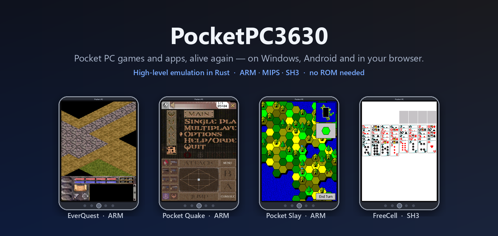
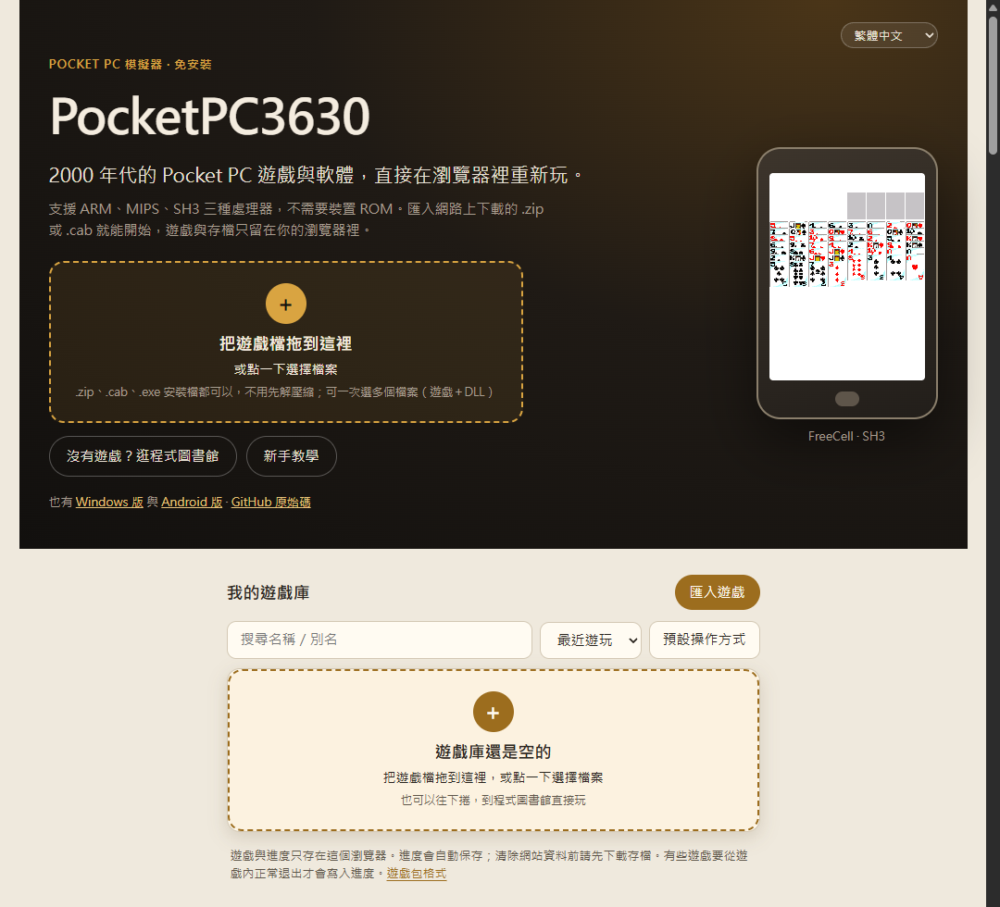
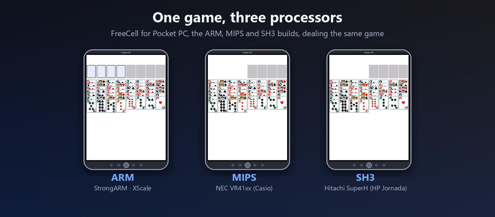
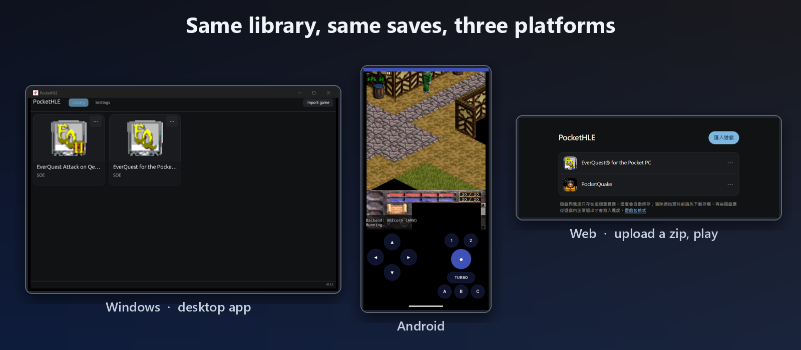
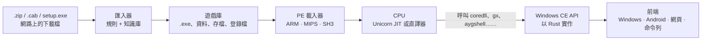

<!--
Copyright (C) 2026 PocketHLE Emulator Project
SPDX-License-Identifier: Apache-2.0 OR MIT
-->

<p align="center">
  
</p>

<h1 align="center">PocketPC3630</h1>

<p align="center">
  <b>讓 Pocket PC 的遊戲與軟體重新動起來。</b><br/>
  在 <b>Windows</b>、<b>Android</b> 與<b>瀏覽器</b>上執行 Windows CE / Pocket PC 程式的高階模擬器，<br/>
  支援 Pocket PC 用過的三種處理器：<b>ARM</b>、<b>MIPS</b>、<b>SH3</b>，不需要裝置 ROM。
</p>

<p align="center">
  <a href="https://szupotseng.github.io/PocketPC3630/"></a>
  <a href="docs/COMPATIBILITY.md"></a>
</p>

<p align="center"><a href="README.md">English</a></p>

---

> ### 👉 馬上試玩：**[szupotseng.github.io/PocketPC3630](https://szupotseng.github.io/PocketPC3630/)**
> 不用安裝。從 **75 款免費的 Pocket PC 遊戲與軟體**（FreeCell、Pocket Quake、Pocket Slay、麻將、俄羅斯方塊、西洋棋……）挑一個按「下載並開始」，就會從 Internet Archive 取得、匯入並直接開始。網站上有完整新手教學：操作方式、存檔、手機上玩、MFC 系統檔怎麼取得。

<p align="center"><a href="https://szupotseng.github.io/PocketPC3630/"></a></p>

PocketPC3630 的名字來自 **Compaq iPAQ H3630**，那台讓 Pocket PC 紅起來的 StrongARM 掌上電腦。
它 fork 自 [PocketHLE](https://github.com/j92580498-max/PocketHLE)，把原本只跑 Pocket PC 2002/2003 ARM 程式的模擬器，擴充成整個 Pocket PC 年代的家：
2000 年的 MIPS Casio Cassiopeia 與 SH3 HP Jornada、點開連結就能玩的網頁版、在電腦/手機/瀏覽器之間通用的存檔，
以及能處理網路上各種下載檔的匯入器。

它不模擬整台機器，而是載入原本的 `.exe`、執行它的機器碼，再用 Rust 重新實作程式呼叫的 Windows CE 功能
（視窗訊息、GDI 繪圖、檔案、登錄檔、聲音、計時器）。所以不需要微軟的 ROM，一秒就能啟動。

## ▶ 馬上玩

| | 方式 | |
|---|---|---|
| 🌐 **瀏覽器** | 打開 **[szupotseng.github.io/PocketPC3630](https://szupotseng.github.io/PocketPC3630/)**，按「匯入遊戲」，選 `.zip` 或 `.cab`。 | 免安裝。內建 **程式圖書館**：收錄 1,202 個 Pocket PC 程式（74 個一鍵就能玩），支援 11 種語言，有盒裝封面、遊戲畫面或程式圖示，可篩選與排序。遊戲與存檔只留在你的瀏覽器。 |
| 🪟 **Windows** | **[下載 zip](https://github.com/SzupoTseng/PocketPC3630/releases/latest/download/PocketPC3630-windows-x64.zip)**，解壓縮後執行 `PocketPC3630.exe`，按 *Import game*。 | 桌面遊戲庫，有圖示、存檔、鍵盤滑鼠操作。 |
| 🤖 **Android** | **[下載 APK](https://github.com/SzupoTseng/PocketPC3630/releases/latest/download/PocketPC3630-android.apk)** 並安裝。 | 觸控方向鍵、動作鍵與連發鍵。 |
| ⌨️ **命令列** | `pockethle play MyGame.zip` | 測試、追蹤呼叫與截圖用。 |

PocketPC3630 **不附任何遊戲，也不附微軟的檔案**。請使用你合法取得的遊戲包。

## ✨ 功能

<p align="center"></p>

### 三種處理器，一個模擬器
早期的 Pocket PC 有三種 CPU，軟體多半也分成三個版本。PocketPC3630 全都能跑：

| 處理器 | 機種 | 狀態 |
|---|---|---|
| **ARM**（StrongARM、XScale、PXA、OMAP、S3C） | Compaq iPAQ、HP iPAQ、Dell Axim、HP Jornada 56x | 可執行：Windows 用 Unicorn JIT，Android 與瀏覽器用可攜式直譯器 |
| **MIPS**（NEC VR41xx） | Casio Cassiopeia E-115/E-125、EM500 | 可執行：新的直譯器，支援延遲槽、likely 分支與非對齊存取 |
| **SH3**（Hitachi SuperH） | HP Jornada 54x | 可執行：新的直譯器，加上 SH 專用的執行期輔助函式 |

兩個新直譯器都逐指令和參考 CPU 比對：**300 組隨機 MIPS 程式**比對 Unicorn，**300 組隨機 SH 程式**比對 QEMU，另有手寫測試。
過程中還找出 QEMU 8.2 SH-4 模擬的四個錯誤（ADDV/SUBV 溢位旗標、除數為零或 `n == m` 的 DIV1、ROTL/ROTR 之後的 T 位元），這些指令改依硬體手冊驗證。

### 同一個遊戲庫、同一份存檔、到處都能玩
<p align="center"></p>

- 所有平台共用同一種存檔格式：一個 `.zip`，內含遊戲的存檔資料夾和登錄檔。在瀏覽器下載存檔、在 Android 匯入，再回 Windows 繼續玩。
- 網頁版是純靜態頁面（沒有伺服器），遊戲與存檔放在 IndexedDB、會自動存檔，並禁止兩個分頁同時執行，避免互相覆蓋進度。
- 每個平台都有「下載存檔」「匯入存檔」「重置存檔」。

### 看得懂真實下載檔的匯入器
網路上的 Pocket PC 軟體很少是乾淨的 `.cab`：有桌面安裝程式、自解壓 zip、藏在 setup 裡的 CAB、1999 年的 SZDD 壓縮檔，或一個 zip 裡放三種 CPU 版本。
匯入器能打開這些檔案，而且**絕不執行它們**：

- **內建的基本規則（快）：** zip、自解壓 zip、從安裝程式切出 CAB、SZDD（`EXPAND.EXE`）、PE 資源、zlib 資料流、校驗碼損壞的 CAB。
- **桌面安裝程式：** Wise、InstallShield（含 InstallShield 3 壓縮檔）、Inno Setup、Setup Factory，以及層層包住的 NSIS 安裝程式，都當成資料拆開，絕不執行。只有 MIPS 或 SH3 版本的下載檔也能匯入。
- **JSON 知識庫：** 決定挑哪個版本（先 ARM、再 MIPS、再 SH3，永遠不選 x86）；記住看過的檔案的確切步驟（`size:crc32` → 步驟）；所有錯誤訊息都有英文與繁體中文。
- **會學習：** 沒有規則適用時，它會在檔案數、位元組數與時間的上限內嘗試所有拆解方式；找到遊戲就把步驟寫進遊戲庫的 `import_kb.json`，下次同類檔案直接匯入。
- **白話的錯誤說明：**「這是 SH3 版……」「需要裝置內建的 `mfcce300.dll`……」「這是 .NET 程式……」，並告訴你下一步該怎麼做。

遊戲包可以放什麼，請見 [docs/PACKAGE_FORMAT.md](docs/PACKAGE_FORMAT.md)。

### 值得逛的程式圖書館
網站的圖書館收錄 **1,202 個 Pocket PC 程式**：archive.org 的下載檔、一套零售光碟收藏、維基百科的 Pocket PC 遊戲列表，以及 Mobile01 Pocket PC 討論串推薦的軟體。

- **每張卡片都有圖：** 606 個有盒裝封面或遊戲畫面，另外 216 個顯示從執行檔取出的程式圖示，其餘顯示所屬分類的插圖。
- **誠實的狀態：** 一鍵就能玩（74）、可執行（207）、部分可用（168）、無法啟動（407）、未測試（186）。結果不是 Pocket PC 程式的下載檔（161）仍保留在清單上，並寫明原因：桌面程式、外掛、裡面沒有東西的安裝程式等。
- **好找：** 可搜尋名稱、說明、收藏與備註；「有圖片」「推薦」快速篩選；排序；說明有六種語言，介面有十一種。80 筆附上 Mobile01 原 PO 的推薦心得。

### 網頁版與 Android 更流暢
瀏覽器與 Android 用的是可攜式直譯器，現在最常用的執行期輔助函式直接在直譯器裡完成，不必走完整的系統呼叫：整數除法與 34 個軟體浮點函式（`__adds` … `__dtos` 與各種比較）。網頁每一輪的執行改成以時間（14 毫秒）為上限，不再只看指令數，忙碌的遊戲不會讓頁面卡住。同一台電腦上：

| 程式 | 之前 | 之後 |
|---|---:|---:|
| PowerVR Racer | 11 fps | 39 fps |
| PowerVR Demos | 34 fps | 53 fps |
| Bejeweled 2 | 1 fps | 10 fps |
| Bookworm | 0.4 fps | 9 fps |
| Doodle Jump | 0.3 fps | 10 fps |

### 一塊一塊重建 Windows CE
這個 fork 在 PocketHLE 之上新增的重點：

- **依 CPU 解析的執行期輔助函式：** MIPS 與 SH3 版的 `coredll` 對編譯器輔助函式（整數除法、浮點運算、64 位元運算）的編號都和 ARM 不同，SH3 的雙精度還用指標傳遞。序號 2005 在 SH 是 `x % n`、在 MIPS 是 `__ll_div`、在 ARM 卻是 `n / x`。現在載入器依 CPU 解析序號，序號表取自 Pocket PC 2000 SDK 各 CPU 版本的 `coredll.lib`。在此之前，SH3 版 FreeCell 的洗牌永遠不會結束，Pocket Slay 的 MIPS 與 SH3 版會在產生地圖時停住。
- **多個計時器：** 以前 `SetTimer` 只會保留最後一個計時器。Pocket Slay 用兩個，所以遊戲一直沒開始。現在所有計時器都會執行，而且永遠先送出最早到期的。
- **單色點陣圖：** 1 位元點陣圖複製到彩色畫面時，會套用目的端的文字色與背景色，和真機一樣。Pocket Slay 的每一塊領地都是這樣上色的。
- **正確的模態對話框：** 對話框開著時底下的視窗仍會重繪；對話框會等你操作；靜態文字會依換行斷行。
- **圖像清單、命令列、Shell 資料夾：** `ImageList_*`、Handheld PC 的 `CommandBar_*`（名稱與序號）、`GetTextMetricsW`、`SendDlgItemMessageW`、`ShellExecuteEx`、`SHGetSpecialFolderLocation`、附可用 COM 配置器的 `SHGetMalloc`、`ExitThread`、`wvsprintfW` 等。
- **MIPS 與 SH3 的隱含核心呼叫：** 它們的 C 執行期會跳到 `0xFFFFFE01` 下方的位址來呼叫部分核心服務，在真機上由核心攔截處理。現在模擬器會直接返回呼叫者（和 ARM 相同），MIPS 與 SH3 程式結束時不再當掉。
- **正確的裁切：** 來源超出點陣圖範圍的複製現在不會畫任何東西，不再繞回圖片左上角。

## 📋 相容性

我們下載了 **archive.org 上找得到的所有 Pocket PC 項目**，逐一匯入，並在網頁版執行 20 秒。

| | 結果 | 數量 |
|---|---|---:|
| ✅ | **可執行**：能啟動並畫出遊戲或程式畫面 | **123** |
| 🟡 | **部分可用**：能啟動，但畫面空白或很快停止 | 128 |
| 🟥 | **無法啟動**：能匯入，啟動時失敗 | 388 |
| ⛔ | **無法匯入**：下載檔裡沒有 Pocket PC 程式 | 384 |
| ⚪ | **未測試**：項目沒有套件，或下載失敗 | 420 |

**→ [完整清單：每個失敗的原因，以及每個程式缺少的 API](docs/COMPATIBILITY.md)**（另有 [CSV](docs/compatibility.csv)）

「可執行」代表程式畫出了自己的畫面，不保證每個功能都正常。
有 73 個程式會呼叫 Pocket PC 內建的 MFC 函式庫 `mfcce300.dll`，缺少時會停止。網頁版一鍵就能從微軟的 Pocket PC 2000 SDK 補上；手動方式見[已知限制](#-已知限制)。

逐一親自驗證過的代表作：

| 名稱 | CPU | 說明 |
|---|---|---|
| **EverQuest for the Pocket PC** | ARM | 第一部與第三部原版安裝包：匯入、啟動與註冊對話框，Windows 與網頁版已驗證。註冊後的遊玩需要你自己的註冊碼，尚未以正版註冊碼驗證。 |
| **Pocket Quake** | ARM | 在瀏覽器中操作選單與遊玩，附螢幕按鍵 |
| **Pocket Slay** | ARM · MIPS · SH3 | 開局時畫面是黑的：點一下畫面，在 *New Game* 按 OK。三個版本都有完整彩色地圖 |
| **FreeCell**（Pocket-G） | ARM · MIPS · SH3 | 三個版本發出完全相同的牌局 |

## 🔧 運作方式



**為什麼模擬作業系統，而不是整台機器？** 請看[為什麼用高階模擬](docs/WHY_HLE.zh-TW.md)：和 QEMU 這類原生裝置模擬器有什麼不同、得到什麼、付出什麼。

## 🛠 從原始碼建置

需要較新的穩定版 [Rust](https://rustup.rs)。

```sh
# 命令列：target/release/pockethle
cargo build --release -p pocket-cli

# Windows / Linux 桌面程式：target/release/pockethle-gui
cargo build --release -p pocket-desktop

# 執行遊戲包
target/release/pockethle play MyGame.zip
```

- **網頁版：** 以 `wasm32-unknown-emscripten` 建置 `pocket-wasm`，再用 `node frontends/pocket-wasm/web/prepare-pages.mjs` 複製到 `docs/`。見 [docs/PAGES.md](docs/PAGES.md)。
- **Android：** 用 `cargo ndk` 建置原生函式庫，再用 Gradle。見 [frontends/pocket-android/README.md](frontends/pocket-android/README.md)。

## 🚧 已知限制

- 為橫向裝置設計的遊戲會畫成側躺的樣子，可以用網頁版的「旋轉畫面」轉正。只支援 Compaq iPAQ 3630 側向畫面記憶體的遊戲（Pocket Hustler）會自動改用那種排列。
- 會開啟多個視窗的 MFC 程式（Haali Reader、SimCity 2000）還無法啟動。現在每個視窗都有自己的 handle（設 `POCKETHLE_MFC_WINDOWS=0` 會回到舊的共用 handle）；和真機還有哪些差異，正用一支在 Device Emulator 上執行的視窗測試程式逐項比對。見 [docs/ROADMAP.md](docs/ROADMAP.md)。
- 少數較少用的 MIPS 與 SH3 輔助函式（SH3 的 64 位元運算、兩者的 `setjmp`）尚未實作。
- 尚不支援 MIPS16 程式碼（部分 MIPS 版）與 SH-4 浮點指令。
- .NET Compact Framework 程式與 x86 版本無法執行。
- 使用 MFC 的程式需要 `mfcce300.dll`。網頁版會自動從 Internet Archive 上微軟的 Pocket PC 2000 SDK 取得。手動方式：用 7-Zip 打開 [SDK](https://archive.org/download/pocketpc_2000_sdk_web/pocketpc_2000_sdk_web.exe)，取出 `Program Files/mfc/lib/arm/mfcce300.dll` 與 `olece300.dll`（MIPS、SH3 版改用 `mips`、`sh3` 資料夾）。為 Pocket PC 2002 編譯的 ARM 程式需要較新的版本，在 [Pocket PC 2002 SDK](https://archive.org/download/WMSDK/ppc2002_sdk.exe) 的 `program files/Pocket PC 2002/mfc/Lib/ARM/mfcce300.dll`。
- Pocket Slay 在瀏覽器中約 1.5 幀/秒。

## ⚖️ 法律聲明

PocketPC3630 用於研究、保存與教育。它不包含任何微軟系統檔案、韌體或遊戲資料。請只使用你合法取得的遊戲與封存檔。
本頁的遊戲截圖是這些遊戲在模擬器中執行的畫面。EverQuest、Quake 等名稱為各自擁有者的商標。
圖書館的封面、截圖與圖示來源，以及如何要求移除：[docs/IMAGES.md](docs/IMAGES.md)。
下載檔如何被安全地拆開、如何回報安全問題：[SECURITY.md](SECURITY.md)。

## 🙏 致謝

- [**PocketHLE**](https://github.com/j92580498-max/PocketHLE) 與其貢獻者，本專案 fork 自它；ARM 模擬器、Windows CE API、桌面與 Android 程式都來自那裡。
- 啟發 PocketHLE 的 [touchHLE](https://github.com/touchHLE/touchHLE) 與 [EKA2L1](https://github.com/EKA2L1/EKA2L1)。
- [Unicorn](https://www.unicorn-engine.org/) 與 [QEMU](https://www.qemu.org/)：MIPS 與 SH 直譯器比對用的參考 CPU。
- Internet Archive，以及所有保存 Pocket PC 軟體的人。

## 📄 授權

與 PocketHLE 相同，採 [MIT](LICENSE-MIT) 或 [Apache 2.0](LICENSE-APACHE) 雙授權。
