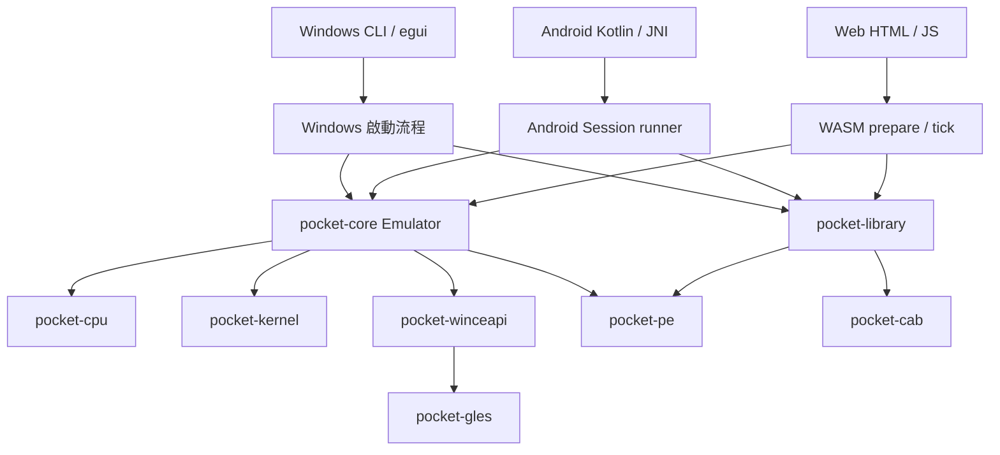

**PocketPC3630 / PocketHLE 0.6.0 現況分析 — 2026-11-07**

本報告依目前工作目錄的原始碼、建置設定與既有實測證據整理。此次重新讀取架構文件、比對前端啟動路徑、核對測試日誌及 24 個產物／截圖雜湊；沒有重跑整套遊戲驗收，也沒有操作 Git 或修改模擬器行為。以下將已確認的程式差異、先前實測結果與待驗證風險分開。

**整體判斷**

這是一套已有實際遊玩能力的 Windows CE 高階模擬器。Windows、Web、Android 已共用 Rust 的 CPU 抽象、PE 載入器、KernelState、Windows CE API、繪圖、音訊混音與檔案／登錄處理。EQ 三部已有進世界及存讀檔證據。

目前最需要改善的是「共用核心之上的啟動規則與測試規格」：各平台仍自行選 CPU、還原登錄值、掛載路徑、設定執行預算。這些重複程式已出現可確認的差異。核心共用是真實的，但不保證各平台會以相同條件啟動同一遊戲。

**1. 專案組成與依賴方向**

Cargo workspace 有 12 個 Rust package：8 個底層／共用 crate，4 個 Rust 前端 package；Android Kotlin app 另由 Gradle 建置。版本 0.6.0 同時出現在 workspace 與 Android versionName。

| 模組 | 實際責任 | 分析 |
| --- | --- | --- |
| pocket-cab | CAB 安裝資訊、解壓與安裝路徑 | EQ owner 文字被誤當路徑的修正位於這層，位置適當 |
| pocket-pe | PE 映像、匯入／匯出、資源及機器型別 | 決定客體架構與 DLL 匯入邊界 |
| pocket-cpu | Cpu trait、Stub、Unicorn、可攜式解譯器 | 底層同套程式可選不同執行實作；Stub 不能當遊玩 CPU |
| pocket-kernel | 記憶體、程序／執行緒狀態、排程、VFS、registry、framebuffer、音訊 | 大量跨遊戲相容性契約集中於此 |
| pocket-winceapi | coredll、GAPI、FMOD、shell、控制項、GLES 等 API | 目前相容性工作量最大的區域 |
| pocket-gles | 軟體 OpenGL ES 1.x | 遊戲繪圖語意在共用層；前端負責呈現結果 |
| pocket-core | Emulator，串接 CPU、載入器、kernel 與 API dispatcher | 約 437 行，主要是組裝與對外介面，並非全部核心程式 |
| pocket-library | 遊戲匯入、metadata、設定、素材辨識、save ZIP | 與 pocket-core 並列，供前端使用；core 目前不依賴 library |

這是 Windows CE API 的高階模擬：客體機器碼執行至 DLL 匯入邊界，再交由 Rust handler 處理。一般執行路徑不需要模擬整套 CE kernel、driver 與 coredll；某些非系統 DLL 仍可載入客體程式碼執行。這讓針對遊戲修正 API 與資源存取相對直接，也表示 API 回傳值、ABI、訊息順序及副作用必須足夠接近原機。

**2. 共用到哪裡，平台仍差在哪裡**

| 項目 | Windows | Web | Android |
| --- | --- | --- | --- |
| 實際遊玩入口 | CLI、egui runner | WASM prepare / pocket_tick | JNI Session runner |
| 本次 EQ 測試 CPU | Unicorn | 可攜式解譯器 | Unicorn，x86_64 Android 模擬器 |
| 原始碼預設／發布設定 | CLI、egui 預設含 Unicorn | WASM 不啟用 Unicorn | JNI 預設含 Unicorn，但 CI／release 明確停用預設 feature，使用解譯器 |
| 主機呈現 | minifb／egui | Canvas | Android GL surface |
| 音訊輸出 | cpal | Web Audio | AudioTrack |
| 儲存媒介 | 主機檔案系統 | MEMFS + IDBFS／IndexedDB | app 專屬檔案區，SAF 匯入／匯出 |
| 執行方式 | 背景或同步 run loop | cooperative tick，讓出瀏覽器主執行緒 | 背景 worker，UI 輪詢影像 |

顯示縮放、旋轉、視窗生命週期與輸出裝置必須留在前端；Windows CE 的繪圖語意、輸入事件契約、檔案／登錄狀態則應共用。

平台不同不一定是缺陷。例如 Web 限制每 slice 指令數至 200,000，並讓出主執行緒，是瀏覽器的必要適配。應統一的是客體可見的語意，不是強迫三平台使用相同的 host loop 或相同預算數字。

**3. 已確認且應優先處理的差異**

| 優先 | 發現 | 證據 | 影響與處理方向 |
| --- | --- | --- | --- |
| P1 | Android 發布版與本機 EQ 測試版 CPU 不同 | .github/workflows/release.yml:80 使用 --no-default-features；本機 APK 報告記錄 Unicorn | 發布版尚未取得相同 EQ 驗收證據；保留解譯器與 Unicorn 兩條測試，或明確選定產品發布後端 |
| P1 | Web 啟動只還原 REG_SZ，未處理 GameEntry.registry 的 dword | frontends/pocket-wasm/src/main.rs:297；Desktop／Android 同段有 dword 分支 | 依賴安裝 DWORD 的遊戲可出現平台差異；應把 registry replay 抽為共用規則 |
| P1 | CPU 偏好模型只有 Stub／Unicorn，沒有 Interpreter | crates/pocket-library/src/lib.rs:479；Android 無 Unicorn 時的 build_unicorn_for_machine 實際回傳解譯器 | 設定與執行 summary 可能標示 Unicorn，實際卻是解譯器；backendName 目前可反映編譯能力，但仍應回報每次 session 的實際後端 |
| P1 | 啟動準備在多個 runner 重複 | Desktop runner、Android runner、WASM prepare、CLI；JNI 還保留舊 runGame | mount、registry、預算與相容性設定會逐步分歧；先統一啟動描述及準備程序 |
| P1 | Android 150 ms 測試短點偶爾漏接，500 ms 可開啟 EP2 Options | cross-platform-verification.json 與實測截圖 | 現象已確認，原因未定位；不能直接歸因 CPU、前端座標或核心事件佇列中的任一層 |

CPU 模型的修正必須兼顧舊設定遷移。例如保留讀取既有 "unicorn"／"stub"，新增明確的 auto／interpreter 選項，並將 requested backend 與 effective backend 分開呈現。不能只改標籤，讓錯誤 fallback 繼續隱藏。

啟動流程建議先建立一份共用 LaunchSpec：客體架構、螢幕、安裝路徑、工作目錄、registry seed、唯讀素材 mount、save overlay、實際 CPU、執行預算及相容性選項。由共用 prepare 程序產生 Emulator；各前端再接自己的 FrameHook、音訊裝置與事件來源。可放於依賴 core + library 的上層模組，避免把 UI 或平台裝置帶入底層。

**4. 目前 EQ 修正的層次合理性**

| 修正 | 所在層 | 已證明的作用 | 尚未證明 |
| --- | --- | --- | --- |
| CAB 文字與路徑正規化分開 | pocket-cab | EP3 owner 不再多出反斜線 | 不是所有安裝器／registry 型別的完整驗收 |
| save overlay 同 prefix 優先，更新前先複製原檔 | pocket-kernel VFS | EP1／EP2 更新寫入指定 saves，安裝素材保持不變 | 儲存空間不足、中斷寫入等故障情境 |
| registry snapshot 隨 save dir 接管 | pocket-core + kernel registry | EP3 乾淨安裝可顯示角色並讀回世界 | 多檔存檔的整體交易一致性 |
| MP3 metadata 初始化及範圍檢查 | 第三方 rmp3 小型 vendor patch | 非音訊資料不再因無效切片範圍中止相關測試 | 完整解碼器安全性與所有音效正確性 |
| 控制項合成保留 frame counter | pocket-kernel | 靜止對話框不因 host 重畫持續冒出新 frame | 所有控制項變動的 dirty signal 完整性 |
| modeless dialog 焦點、style、CE tagged colors | pocket-winceapi / kernel | 部分 CE 行為已有 probe 與回歸測試 | EP3 原版註冊 GUI 的 owner 初始化、字型及幾何完整一致 |
| 原生鍵盤由 held state 產生 edge | CLI display adapter | EP3 靜態註冊欄位可輸入，避免 slice 重播按鍵 | Android 短觸控問題仍是另一項待查現象 |

大部分修正在共用資料入口或共用行為層，能同時改善各平台。原生鍵盤 polling 的修正屬 CLI 轉接層，留在前端是合理的；不需要為了「共用」把主機視窗 API 放進 kernel。

**5. 遊戲實測的真實完成範圍**

| 平台 | EP1 | EP2 | EP3 |
| --- | --- | --- | --- |
| Windows 原生 CLI 視窗 | Freeport；移動、背包、法術書、任務、地圖、設定、存讀檔 | Qeynos；介面、NPC 對話、第一段任務更新及新程序讀檔 | Butcherblock；25 級 Warrior、移動、地圖及乾淨安裝讀檔 |
| 真正 Chrome Web UI | 匯入、進世界、移動、存檔與頁面重載 | 相同基本流程 | 相同基本流程 |
| Android 14 x86_64 + 本機 Unicorn APK | 匯入、進世界、橫向／全螢幕、移動、重啟讀檔 | 匯入、進世界、Options Exit 寫出新 SAV、重啟讀檔 | 匯入、進世界、移動、Options、重啟讀檔 |

Windows 的既有操作證據主要來自 CLI 的 minifb 視窗；不能因此宣稱 egui launcher 的整套 UI 也逐項完成驗收。Web／Android 的介面深度也沒有 Windows 那麼完整。

（整合時更正）上表的遊玩結果是在 Codex 工作區用修改過的執行檔與非測試者本人的註冊資料取得，本專案不採用；原版安裝包的有效驗證範圍是匯入、啟動與註冊對話框。

仍缺：戰鬥、商店、完整任務、死亡／復活、長時間遊玩、ARM64 實機、音訊聽測、同素材 CE 裝置畫面的系統性比對。部分音效有讀取警告；EP2 的六個特定怪物音效曾確認不在目前素材中，但不能把所有音效警告一概視為素材問題。

**6. 顯示、輸入與音訊應如何定位**

顯示分成兩層：共用核心產生 framebuffer，主機端再縮放／旋轉／呈現。GDI、GAPI 與 GLES 的遊戲可見行為屬核心；Canvas、GL surface、minifb 的顯示座標與視窗配置屬前端。frame_counter 只代表變更影像訊號，不是客體 CPU 執行量，也不是標準化效能基準。

Android 短點問題要量測三個位置：MotionEvent 與 JNI 入佇列時間、SessionHook 轉送時間、客體實際消費 WM_LBUTTON／GetKeyState／GetAsyncKeyState 的時間。不同 API 的 polling 語意不能混改；docs/AGENTS.md 已要求 GetKeyState 保留未消費短按邊緣，而 GetAsyncKeyState 反映最新物理狀態。以延長測試工具按壓掩蓋問題，無法取代根因修復。

音訊共用解碼／混音，輸出裝置分平台。沒有 audio-cpal 的 Web／Android 仍可經 AudioTap 交由 Web Audio／AudioTrack 輸出；看到「without audio-cpal」警告，不能單憑它判定整個平台無聲。反之，PCM 非靜音也不能證明使用者已聽到正確混音。需要分別量測提交、混音、輸出 buffer，以及實際錄音／聽感。

效能尚無可公平比較三平台的 benchmark。Web 與 Android 截圖 HUD 中的 FPS 受場景、dirty-frame 計數、host 排程與不同 CPU 後端影響，不能據此直接比較解譯器與 Unicorn。應固定存檔、輸入腳本、場景與 warm-up，記錄載入時間、操作延遲、p50/p95 frame 間隔、CPU 與音訊 underrun。

**7. 可靠性與維護風險**

以下為程式碼分析指出的風險，沒有在本輪故障注入實測中重現：

1. save_archive::import 會先把合法 ZIP 項目讀入記憶體，再 reset 舊存檔、逐檔寫入。格式驗證失敗不會先刪舊檔，這點良好；但驗證後若遇到磁碟寫入失敗，整包替換仍可能只完成一部分。每項限制 64 MiB，尚無整包總大小／數量上限。宜採 staging + 可回復替換，並加入合理總量限制。
2. registry 自己使用 temp + rename，但遊戲 SAV、CSS 與 registry 並非同一交易。現有正常關閉／重開成功，不代表程序突然終止時仍維持一致；需故障注入後再決定備份或恢復策略。
3. Web 每次 start 都新增輸入 listener、AudioContext／WASM buffer 與自動同步 timer，未見相應 session cleanup。正常按「遊戲庫」會 reload，能讓頁面資源釋放，因此一般返回流程不能直接判成洩漏；但遊戲自然結束後不 reload 就再次啟動的路徑值得針對重複 handler、音訊消費者及 timer 測試。
4. coredll.rs 約 24,888 行，pocket-winceapi 的 Rust 原始碼約 34,690 行；變更影響面大。適合依訊息／控制項、GDI、檔案、同步等行為邊界逐步拆分，每次保留回歸測試與現有 handler key；不適合在遊戲仍有未定位問題時做整檔重寫。
5. 文件有局部落差：架構表仍把 CPU 描述為 Stub／Unicorn 兩種，實際另有解譯器；部分 JNI feature 註解也仍稱無預設 feature 會退成 trace-only，實際 session runner 可用解譯器。應以程式實際行為修正文案與診斷輸出。

API dispatcher 有實作 handler、常數 stub 與未實作 fallback。匯入可解析、handler 有登記、甚至回傳成功，都不等於符合完整 CE 語意。相容性報告應區分這些層級；否則遊戲能啟動，卻可能在很後面的任務或音效路徑才失敗。

**8. 品質與建置現況**

- 既有最後一次 runtime 修正後的 workspace 日誌重新加總：588 passed、0 failed、11 ignored；其中 10 個為 JIT microbenchmark，1 個為 SH 診斷 trace。這是既有紀錄核對，不是本輪重跑。
- 先前 fmt 成功；Clippy exit 0 仍有 unknown lint 警告，不能稱作無警告。CI 用 -D warnings，門檻比該本機紀錄嚴格；未重新執行相同 CI 命令前，不能聲稱目前 CI 必定綠燈。
- 驗證工具 Windows Node 測試為 5 passed，屬工具契約／情境格式測試，不是五場完整遊戲測試。
- 既有本機 WASM、Android ARM64／x86_64 native library、clean debug APK 建置成功；APK 29,726,965 bytes。ARM64 編譯通過不等於 ARM64 實機通過。
- 本輪重新檢查跨平台報告列出的 24 個模組、APK 與截圖雜湊，皆與檔案相符。
- CI 已有 Linux／Windows／WASM／Android 建置；目前 YAML 中未看到 EQ 的實際瀏覽器／Android 操作驗收工作。建置綠燈與 EQ 行為綠燈仍是兩件事。
- 有些 CPU 測試受 feature 或 ignored 條件控制；588 的總數無法代表每種後端都跑完同一套測試。應把 Interpreter／Unicorn、native／WASM／Android 的矩陣列清楚。

**9. 建議改善順序與驗收條件**

| 階段 | 工作 | 完成條件 |
| --- | --- | --- |
| A：啟動一致性 | 共用 registry replay；明確 actual backend；共用 LaunchSpec／prepare | 同一小型合成程式在各平台讀到相同字串／DWORD、module path、working dir、唯讀素材與 save 路徑；保留舊設定可讀 |
| B：發布設定一致性 | 用真正 release 的 Android 解譯器配置跑 EQ；另留 Unicorn 對照 | 報告可識別 CPU、feature、APK 雜湊與素材；避免拿 debug Unicorn 結果代替 release Interpreter |
| C：輸入可靠性 | 量測並定位短按事件消費；涵蓋旋轉後座標 | 合成程式與 EQ 均測多種按壓時間、連點、拖曳、cancel、橫向／全螢幕；無重複或卡住按鍵 |
| D：完整遊戲行為 | 三部共用測試清單與可重播存檔 | 新建角色、戰鬥、物品、商店、任務、地圖、死亡、存讀檔、長時間與音訊逐項有證據 |
| E：資料與資源生命週期 | 存檔匯入復原、故障注入、Web session cleanup | 模擬磁碟錯誤／中斷後保住舊進度；同頁反覆啟停沒有累積 listener／音訊／timer |
| F：可維護性與效能 | 依行為拆 API 模組、標準化 benchmark | 拆分不改 ABI；固定場景可比較效能及操作延遲；平台間差異可追溯 |

不建議現在另寫一套 Android／Web EQ 修補邏輯，也不需要為了既有 APK 再建立新平台。最有價值的是讓共用核心的修正，經過同一啟動規則與明確的後端矩陣，可靠地到達每個現有產品。

**主要來源**

- [架構契約](AGENTS.md)
- [Emulator 與 save mount](../crates/pocket-core/src/lib.rs)
- [遊戲 metadata 與 CPU 偏好](../crates/pocket-library/src/lib.rs)
- [存檔 ZIP](../crates/pocket-library/src/save_archive.rs)
- [Desktop runner](../frontends/pocket-desktop/src/runner.rs)
- [Android runner](../frontends/pocket-android-jni/src/runner.rs)
- [WASM prepare / tick](../frontends/pocket-wasm/src/main.rs)
- [Web 前端來源](../frontends/pocket-wasm/web/index.html)
- [Android 發布設定](../.github/workflows/release.yml)
- [跨平台實測證據](../tools/eq-validation/cross-platform-verification.json)
- [EQ 改善紀錄](EQ_IMPROVEMENTS.md)
