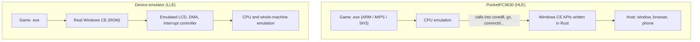

# Why high-level emulation?

[繁體中文](WHY_HLE.zh-TW.md)

PocketPC3630 (a fork of PocketHLE) is a **high-level emulator (HLE)**: it emulates only the CPU and reimplements the Windows CE operating system in Rust. Microsoft's Device Emulator and QEMU-style **device emulators** are **low-level emulators (LLE)**: they emulate the whole machine's chips and circuits and boot a real copy of Windows CE on top.

The two approaches differ in how they work, how fast they run, where they can run and how much work they take to build.

## How they differ

| | PocketPC3630 (HLE) | Device emulator (LLE, e.g. QEMU) |
|---|---|---|
| What is emulated | Only CPU instructions. The OS and hardware are implemented directly in Rust | The whole chipset and its circuits, running a **real Windows CE image (ROM)** |
| Operating system | **No Microsoft OS files needed.** A call into `COREDLL.dll` lands in a Rust function | A full OS image is required; APIs run inside Microsoft's own system in the VM |
| Hardware | Touch, display, timers and sound go straight to the host: egui on the desktop, Canvas and Web Audio in the browser, native UI on Android | The LCD controller, DMA and interrupt controller of the era must be emulated for the OS drivers to drive |
| CPU | Unicorn on Windows (QEMU's dynamic binary translation, a JIT); our own ARM, MIPS and SH interpreters on Android and the web | Usually dynamic binary translation too, but running the whole OS as well |

## Five advantages

### 1. Fast, with little overhead

Under LLE the virtual CPU runs the game plus the Windows CE kernel, memory management (page tables), file system drivers and the shell in the background.

HLE has none of that. The virtual CPU runs only the game's own instructions, and when the game draws (`BitBlt`), sets a timer or reads a file, that work happens at the host's native speed. EverQuest runs at about 48 fps on Android.

### 2. Truly cross-platform

Whole-machine virtualisation is heavy and hard to fit in a browser. PocketPC3630 is essentially a modern program with a Windows CE compatibility layer, and the same Rust code builds into:

- a Windows desktop program
- an Android APK
- WebAssembly: open the page, drop in a 20-year-old ARM, MIPS or SH3 program and play, with no virtual machine to install

### 3. No Microsoft OS image needed

To run Pocket PC software under LLE you first need one of Microsoft's Pocket PC ROMs, which are copyrighted and have no clear legitimate source.

PocketPC3630 needs no ROM. `coredll`, `commctrl`, `aygshell` and the other system components are reimplemented, and the repository contains no Microsoft binaries, so it can be published openly on GitHub. That makes preserving and replaying old software much easier.

A few programs need libraries built into the device, such as MFC's `mfcce300.dll`. Users get those from Microsoft's public Pocket PC 2000 SDK; we do not redistribute them.

### 4. Easy to debug, driven by data

When a program crashes in an LLE you usually get a Data Abort and little idea where in Microsoft's system it died.

Under HLE every API call goes through our code, so we can:

- record which APIs each program calls, which are missing and where it stopped
- test all 1,023 Pocket PC downloads from archive.org in parallel and rank, within minutes, the APIs the most programs are missing, which decides what to build next (command bars, multiple timers, per-CPU runtime helpers)
- rerun the whole batch after each change to catch regressions

The results are in the [compatibility list](COMPATIBILITY.md).

### 5. Fits modern screens and input

An LLE usually draws a fixed 240×320 screen. HLE's drawing and input layers talk to modern frontends directly, so it can:

- scale the window, go full screen, enlarge on phones
- rotate the picture 90° so landscape games stand upright
- map the stylus to a mouse or finger, and the D-pad and action key to a keyboard or on-screen buttons
- later add filters or Bluetooth controllers

## The cost: a lot of compatibility work

The one big cost of HLE is the amount of development and maintenance.

- **LLE**: emulate the hardware, install Microsoft's OS, and most software just works, because the real Windows CE is underneath.
- **HLE**: one missing API and the program stops. Every API has to be filled in to behave like a real device, including the details nobody documented.

Examples from this project:

- The SH3 and MIPS runtime helpers (integer division, floating point) have different ordinals in `coredll.dll` than the ARM ones. Mapped wrongly, arithmetic such as `Random() % n` goes wrong, and Pocket Slay's SH3 build hangs while generating its map.
- Pocket Slay runs several timers at once; with only one supported, its screen froze.
- Pocket Hustler only understands the Compaq iPAQ 3630's display memory layout (a sideways 320×240 panel), so GAPI has to answer the way that device did.
- File managers need system controls such as `SysTreeView32` and `SysListView32`, with their whole set of messages and notifications.

Compatibility grows one API and one behaviour at a time. Today 123 of the 1,023 downloads start and draw their screen.

## In short

HLE puts the burden on the developers and gives the users speed, portability and convenience. It does not replace QEMU-style hardware tools, but for getting old Pocket PC software played on today's browsers and phones, it is the practical way.
