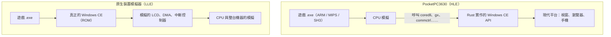

# 為什麼用高階模擬（HLE）？

[English](WHY_HLE.md)

PocketPC3630（衍生自 PocketHLE）用的是**高階模擬（HLE, High-Level Emulation）**：只模擬 CPU，Windows CE 作業系統則用 Rust 重新寫一份。微軟的 Device Emulator、QEMU 這類**原生裝置模擬器**用的是**低階模擬（LLE, Low-Level Emulation）**：模擬整台機器的晶片與電路，再在上面開機一份真正的 Windows CE。

兩種做法在原理、速度、可移植性和開發成本上差很多。

## 運作原理的差異

| | PocketPC3630（HLE） | 原生裝置模擬器（LLE，如 QEMU） |
|---|---|---|
| 模擬什麼 | 只模擬 CPU 指令。作業系統與硬體改用 Rust 程式碼直接實作 | 模擬整組晶片與硬體電路，上面要跑一份**真實的 Windows CE 映像檔（ROM）** |
| 作業系統 | **不需要微軟的 OS 檔案**。遊戲呼叫 `COREDLL.dll` 時，直接跳到我們用 Rust 寫的函式 | 必須自備完整 OS 映像檔，API 由虛擬機裡那份真正的微軟系統執行 |
| 硬體 | 觸控、畫面、計時器、聲音直接接到現代平台：桌面版用 egui，網頁版用 Canvas 與 Web Audio，Android 用原生介面 | 必須模擬當年的 LCD 控制器、DMA、中斷控制器，再由 OS 的驅動程式去驅動 |
| CPU | Windows 版用 Unicorn（QEMU 的動態二進位翻譯，JIT）；Android 與網頁版用自己寫的 ARM、MIPS、SH 直譯器 | 通常也是動態二進位翻譯，但要連整個 OS 一起跑 |

## HLE 的五個好處

### 1. 速度快、負擔小

LLE 的虛擬 CPU 除了跑遊戲，還要跑 Windows CE 核心、記憶體管理（分頁表）、檔案系統驅動，以及背景的系統介面。

HLE 沒有這些背景負擔，虛擬 CPU 只執行遊戲本身的指令。遊戲要畫圖（`BitBlt`）、設計時器或讀檔時，這些工作直接用現代電腦或手機的原生速度完成。實測 EverQuest 在 Android 版跑到約 48 fps。

### 2. 真正跨平台：網頁、手機都能跑

整機虛擬化很沉重，很難放進瀏覽器。PocketPC3630 本質上是「內建 Windows CE 相容層的現代程式」，同一份 Rust 程式碼編譯成：

- Windows 桌面程式
- Android APK
- WebAssembly：打開網頁，把 20 年前的 ARM、MIPS、SH3 程式拖進去就能玩，不用安裝任何虛擬機

### 3. 不需要微軟的作業系統映像檔

要讓 LLE 跑 Pocket PC，得先取得微軟當年的 Pocket PC ROM，這些映像檔有版權問題，取得管道也不明確。

PocketPC3630 不需要任何 ROM。`coredll`、`commctrl`、`aygshell` 等系統元件都是重新實作，repo 裡沒有任何微軟的二進位檔，所以可以公開放在 GitHub。這讓古董軟體的保存與重玩容易得多。

少數程式需要裝置內建的函式庫（例如 MFC 的 `mfcce300.dll`），這部分由使用者自行從微軟公開的 Pocket PC 2000 SDK 取得，我們不重新散布。

### 4. 好除錯、能用數據驅動開發

在 LLE 裡程式崩潰，通常只看到一個 Data Abort，很難知道它死在微軟系統的哪一步。

HLE 的每一個 API 呼叫都經過我們自己的程式碼，所以能：

- 記錄每個程式呼叫了哪些 API、哪個沒實作、在哪裡停下
- 平行自動測試 archive.org 上的 1,023 個 Pocket PC 下載檔，幾分鐘內統計出「最多程式缺少的 API」排行榜，依此決定下一步先補什麼（例如命令列 CommandBar、多計時器、各 CPU 的執行階段輔助函式）
- 每次修改後重跑整批測試，確認沒有退化

完整結果在[相容性清單](COMPATIBILITY.md)。

### 5. 直接接上現代螢幕與輸入

LLE 通常只會畫出一個 240×320 的小螢幕。HLE 的繪圖與輸入層直接接到現代的前端，所以可以：

- 縮放視窗、全螢幕、在手機上自動放大
- 把畫面旋轉 90°，讓橫拿的遊戲轉正
- 把觸控筆對應到滑鼠或手指，把方向鍵和動作鍵對應到鍵盤或螢幕按鈕
- 未來還可以加上濾鏡或藍牙手把

## 代價：大量的相容性工作

HLE 唯一、也是最大的代價是開發與維護的工作量。

- **LLE**：只要把硬體模擬好、灌進微軟的作業系統，大部分軟體自然就相容，因為底層是真正的 Windows CE。
- **HLE**：少一個 API，程式就停下來。每個 API 的行為都要照著真實裝置一個一個補齊，包括文件沒寫清楚的細節。

這個專案遇過的例子：

- SH3 與 MIPS 版的執行階段輔助函式（整數除法、浮點運算）在 `coredll.dll` 的序號和 ARM 版不同。對應錯了，`Random() % n` 這類運算就算錯，Pocket Slay 的 SH3 版會卡在產生地圖。
- Pocket Slay 同時用好幾個計時器，只支援一個計時器時畫面就停住。
- Pocket Hustler 只認 Compaq iPAQ 3630 的畫面記憶體排列（側放的 320×240 面板），要照那台機器回報 GAPI 參數才畫得出來。
- 檔案總管類程式需要 `SysTreeView32`、`SysListView32` 這類系統控制項，得自己實作整套訊息與通知。

相容性就是這樣一個 API、一個行為地往上推。目前在 1,023 個下載檔中，有 123 個可以啟動並畫出畫面。

## 總結

HLE 是把重擔留給開發者，把效能、跨平台和便利留給使用者。它不是要取代 QEMU 這類硬體開發工具；但若目標是讓古董 Pocket PC 軟體在今天的瀏覽器和手機上被普遍玩到，HLE 是最實際的路。
